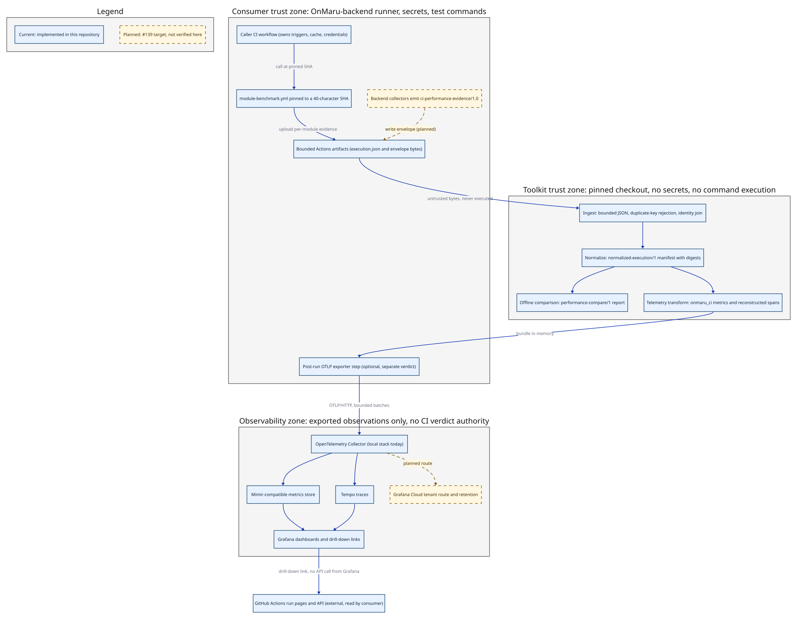
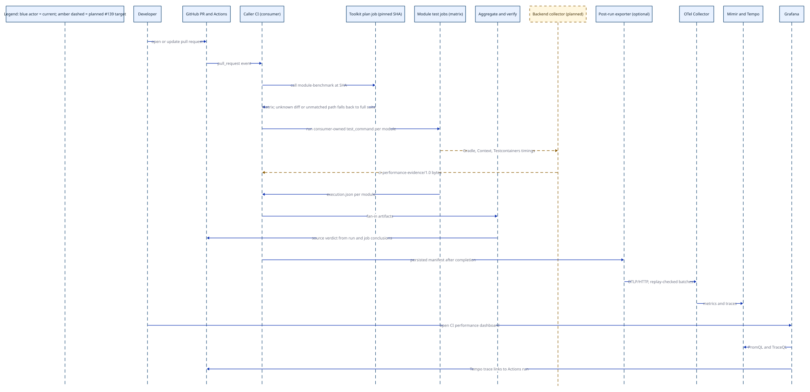
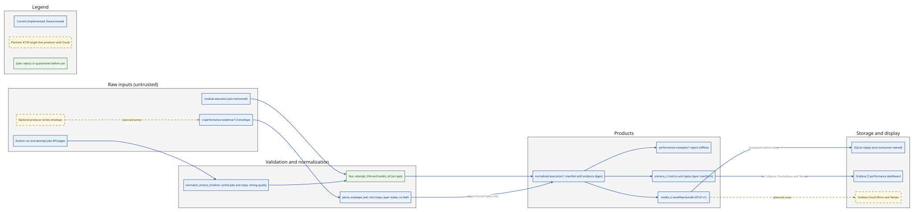
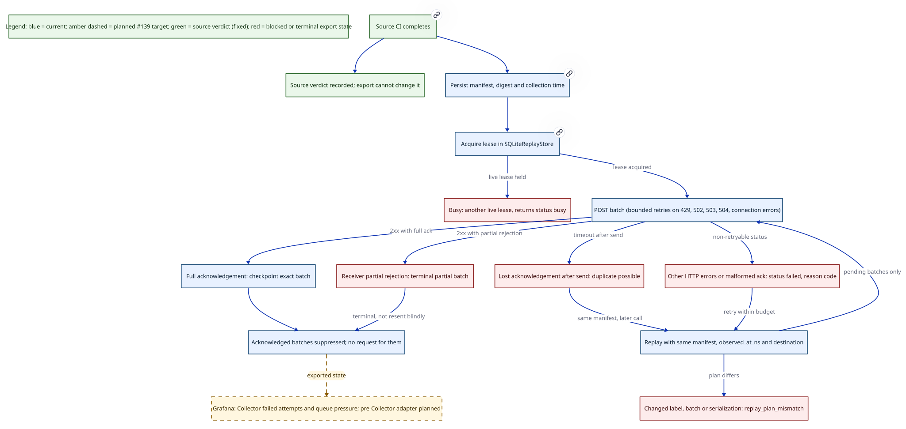

# 그림 목록

이 문서는 아키텍처 그림 네 개의 캡션, 대체 텍스트, 범례, 근거 파일을 모은다. 원본은 `docs/diagrams/*.d2`이며, SVG는 그 원본에서 생성된 결과물이다. SVG를 손으로 고치지 않는다. 생성과 drift 검사는 `python3 scripts/check_pipeline_docs.py`가 맡는다. README의 전체 개요 그림은 Mermaid로 따로 있다.

범례는 모든 그림에서 같다. 파란 상자와 실선 화살표는 이 저장소에서 구현되고 fixture로 검증된 항목이다. 노란 점선은 #139 목표로, 아직 live 검증되지 않았거나 이 저장소 밖(Backend 또는 Cloud)에 있는 항목이다. 녹색은 source CI 판정처럼 export와 무관하게 고정된 경로이다. 빨간 상자는 차단되거나 terminal 상태가 된 export 결과이다.

## 그림 1. 시스템 맥락과 신뢰 경계

캡션: Toolkit은 consumer의 artifact를 신뢰하지 않는 데이터로 읽고, 관측 영역은 판정 권한 없이 exported 관측만 보여 준다.

대체 텍스트: 왼쪽 위 consumer 영역에서 caller workflow가 고정 SHA의 reusable workflow를 호출하고 artifact를 올린다. artifact는 Toolkit 영역의 수집, 정규화, 비교, 변환으로 흐르며, 변환 결과는 선택적 OTLP 단계를 거쳐 Collector, metric 저장소, Tempo, Grafana로 이어진다. Grafana는 GitHub 실행 페이지로의 링크를 가진다. Backend producer와 Cloud route는 점선이다.

범례: 파란 상자는 현재 구현, 노란 점선 상자는 #139 목표이다.

근거: [README 사용 경계](../../README.md), [reusable 모듈 workflow](../../.github/workflows/module-benchmark.yml), [정규화 계약](../../src/pipeline_toolkit/normalize/performance.py), [OTLP 전달](../../src/pipeline_toolkit/telemetry/export.py), [로컬 관측 스택](../../observability/local/compose.yaml), [맥락 문서](context.md).

## 그림 2. PR에서 Grafana까지의 순서

캡션: 실행 결론은 집계 단계에서 먼저 정해지고, 관측 전달은 완료된 manifest를 나중에 읽는다.

대체 텍스트: 개발자가 PR을 열면 GitHub가 caller에게 이벤트를 보낸다. caller는 계획 job을 고정 SHA로 호출하고, 계획 job은 matrix를 돌려준다. 모듈 test job은 consumer 명령을 실행하고 Backend producer에 시간을 보낸다(계획). envelope과 execution artifact가 caller로 돌아오고, 집계 단계가 판정을 GitHub에 남긴다. 이후 exporter가 manifest를 OTLP로 보내고, Grafana는 PromQL과 TraceQL로 조회하며 Tempo 링크로 실행을 가리킨다.

범례: 파란 actor와 실선은 현재 구현, 노란 점선 actor와 화살표는 Backend collector 계획이다.

근거: [계획 job과 fail-closed matrix](../../src/pipeline_toolkit/catalog/planner.py), [reusable workflow](../../.github/workflows/module-benchmark.yml), [집계 quality 계산](../../src/pipeline_toolkit/normalize/performance.py), [OTLP exporter](../../src/pipeline_toolkit/telemetry/export.py), [CI 성능 대시보드](../../observability/dashboards/ci-performance.json), [호출 흐름 문서](call-flow.md).

## 그림 3. 데이터 계보

캡션: 모든 파생 값은 manifest 하나로 거슬러 올라갈 수 있고, envelope 바이트는 digest가 맞을 때만 manifest에 들어간다.

대체 텍스트: 왼쪽의 세 원시 입력은 jobs API 페이지, module execution artifact, envelope이다. Backend producer의 envelope 작성은 계획이다. 검증 단계는 시간선 정규화와 join 게이트를 거쳐, digest가 맞는 envelope과 함께 normalized-execution manifest를 만든다. manifest는 비교 보고서, layer 변환, OTLP bundle로 나뉜다. OTLP는 replay 저장소에 checkpoint를 남기고, 대시보드로 가며, Cloud 경로는 계획이다.

범례: 파란 상자는 구현된 단계, 초록 상자는 입력이나 결과를 거부하는 게이트, 노란 점선은 계획이다.

근거: [jobs API 수집](../../src/pipeline_toolkit/github/responses.py), [시간선 정규화](../../src/pipeline_toolkit/telemetry/timeline.py), [envelope 계약](../../src/pipeline_toolkit/contracts/performance_evidence.py), [envelope 스키마](../../schemas/ci-performance-evidence-1.0.json), [layer 변환](../../src/pipeline_toolkit/telemetry/transform.py), [비교 엔진](../../src/pipeline_toolkit/compare/performance.py), [증적 문서](evidence.md).

## 그림 4. 실패와 replay의 생명주기

캡션: export가 실패하거나 부분 거부되어도 원래 CI 판정은 바뀌지 않고, 다시 보내는 범위는 확인되지 않은 batch로 제한된다.

대체 텍스트: 완료된 CI는 녹색 판정 경로로 고정된 결론을 남기고, 동시에 manifest를 저장한다. export는 lease를 얻는다. 다른 lease가 살아 있으면 busy로 끝난다. 얻으면 batch를 보내며, 확인을 받은 batch는 checkpoint가 되고, 수신자의 부분 거부는 terminal이 된다. 다른 HTTP 오류나 잘못된 응답은 failed가 된다. 확인 없이 timeout이 나면 중복 가능성이 있으므로 같은 manifest로 나중에 replay한다. replay가 계획과 다르면 `replay_plan_mismatch`로 멈춘다. Grafana 패널의 대기 상태는 계획 항목이다.

범례: 파란 상자는 구현, 빨간 상자는 차단되거나 terminal 상태, 노란 점선은 계획, 녹색은 고정된 CI 판정이다.

근거: [SQLite replay 저장소와 export 상태](../../src/pipeline_toolkit/telemetry/export.py), [source verdict 계산](../../src/pipeline_toolkit/normalize/performance.py), [OTLP 문서의 replay 절](../telemetry/otlp-export.md), [대시보드 경계](../telemetry/dashboard.md), [결과 구분 문서](outcomes.md).
