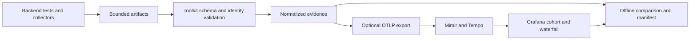

# CI 성능 관측 플랫폼: 원시 증적에서 재현 가능한 비교와 Grafana 탐색까지

상태: 2026-11-20 통합 기획 및 Issue 분해 제안. #139·#140의 본문과 댓글, [측정 검토](../../telemetry/measurement-rollout-review.md)를 통합했다. 실제 구현 완료를 의미하지 않는다. 이전 논의의 이름·cache·표본 조건과 충돌하면 이 문서의 보정된 계약을 따른다.

## 느린 job을 찾은 다음 실제 원인까지 추적한다

현재 Toolkit은 Actions timeline, module benchmark, OTLP export와 replay, Grafana dashboard를 제공한다. Consumer는 SHA-pinned reusable workflow와 같은 SHA의 Python source checkout으로 사용한다. 일반 CI의 job catalog는 consumer adapter에서 비어 있고, Gradle·Spring Context·Testcontainers·Flyway 내부 evidence는 아직 통합 계약이 없다. 전체 시간이 줄어도 무엇을 줄였는지 설명하기 어려운 상태다.

개발자는 Grafana에서 느린 실행 집단을 찾고, Tempo의 구간과 source manifest를 통해 초기화·테스트·cache 비용을 구분해야 한다. Maintainer는 비교 조건 불일치와 수집 누락을 판별해야 한다. Release 담당자는 Toolkit 비교 보고서를 읽되 실제 승격할 SHA의 전체 회귀 판정은 consumer에서 확인한다.

## Toolkit과 consumer는 서로 다른 결과물을 소유한다

Backend #867은 Gradle 9.7.1·JUnit·Spring Context·Testcontainers·Flyway collector, affected planner, 실제 테스트 명령, credential과 exact-SHA gate를 소유한다. Toolkit은 consumer artifact를 데이터로 검증하고 정규화·비교·OTLP 변환·시각화한다. Marketplace/PyPI 배포와 runtime library 설치, consumer의 deployment 권한 이전은 이번 범위에 없다.

## Evidence는 값과 품질을 함께 전달한다

새 performance envelope `ci-performance-evidence/1.0`은 기존 module evidence schema와 별도 namespace를 사용한다. Run/attempt/source SHA·producer/collector/schema version·toolchain·clock anchor·quality를 포함한다. task category별 duration/outcome, discovered/selected/executed_now/verified_from_cache/failed/skipped, Context 생성·reuse, container 준비, Flyway와 자원 사용량을 optional measured field로 표현한다. 측정하지 못한 값은 unavailable이며 0으로 바꾸지 않는다. serializer의 정확한 필드명과 JSON Schema는 계약 작업 W0에서 fixture와 함께 확정한다.

기존 `cache_state: str`은 legacy reader에서 `legacy-limited`로 해석한다. 새 writer는 dependency/Build/Configuration/container image별 policy와 outcome을 구조화한다. 기존 warm/cold에서 세부 layer를 추론하지 않는다. schema가 달라도 의미 보존 변환을 검증할 수 있으면 변환 후 비교하고, 불가능하면 incomparable로 남긴다.

Task와 Context/container/Flyway 시간은 중첩될 수 있다. process별 monotonic duration과 UTC anchor·uncertainty를 함께 보존하고 causal graph가 없으면 critical path는 unavailable이다. 일부 task 시간을 전체 configuration 시간이라고 추정하지 않는다.

## 실험은 허용 차이를 먼저 선언한다

Cache/worker 실험은 같은 source와 test universe/selected plan을 유지한다. Affected 실험은 selected plan의 차이를 허용하되 전체 universe와 변경 시나리오를 고정한다. Slice 전환은 scenario/assertion 보존 증거가 필요하다. Cache 도입은 disabled→enabled가 허용 변수이며 이를 무조건 비교 불가 처리하지 않는다.

Controlled-cold, controlled-warm, realistic-pr를 분리하고 policy·seed input digest와 실제 hit/miss를 기록한다. fresh runner와 cold cache는 다르다. Seed는 warm 표본에서 제외한다. 서로 다른 조건을 조용히 같은 집합에 합치지 않는다.

초기 baseline/candidate는 각각 최소 3회, 사전 등록한 3~5회와 AB/BA 순서로 개별값·중앙값·범위를 보고한다. 실패·취소·retry와 exclusions는 별도 분모로 보존한다. p95는 초기 표본에서 insufficient-samples이고 동일 cohort rolling 14일 100건 이상에서 표본 수와 함께 표시한다. 이 숫자는 초기 운영 정책이며 통계적 보장은 아니다. Histogram 추정치와 원시 분위수를 구분한다.

Collector off/on 예산은 consumer workflow 중앙값의 3% 또는 15초 중 작은 값이다. latency 외에 runner-minutes·concurrency·cache/artifact bytes를 비교한다. 시간 절약 추정치는 검증된 대응 표본이 있을 때만 제공한다. Toolkit 성공 기준은 비교·측정 정확성이며 Backend CI 40% 단축은 consumer의 목표다.

## 파이프라인은 검증·관측·비교의 경계를 드러낸다

*목표 구조다. 새 계층별 evidence 연결은 구현 예정이며 source CI verdict와 export 결과는 독립이다.*

Bounded logical job ID는 change-plan, repository-hygiene, spring-affected, spring-full, contract-validation, ai-quality, required-verdict를 지원한다. 표시명 변경이 identity 변경이 되지 않도록 명시적으로 매핑하고 unmapped는 other와 quality로 드러낸다. SHA·run URL·test class는 metric label에 넣지 않는다. parsed artifact의 script/command를 실행하지 않는다.

OTLP는 explicit histogram bucket, temporality, replay idempotency와 기존 label/span budget을 검증한다. Dashboard는 Gradle category/cache/Context/container/Flyway와 fallback/mismatch/quality/overhead/비용을 표시한다. 중첩 시간은 waterfall로 탐색하고 테스트 시간에 재합산하지 않는다. Source digest와 Actions/Tempo/manifest 링크가 같은 실행을 가리켜야 한다.

## README와 시각화도 제품 계약의 일부다

#140은 README Mermaid overview, D2 source와 generated SVG, context·sequence·data lineage·failure/replay 문서를 소유한다. Archify는 선택적 HTML/SVG 탐색 산출물이며 typed source·사용 ref·재현 명령을 함께 보존한다. 모든 node/edge는 source link와 current/planned legend를 가진다. 생성물 drift·link·clipping·contrast·alt text를 검증한다.

Live 문서·fixture·query는 현재 계약으로 이전하고 historical 보고서·ADR 수치는 보존한다. workflow identity CI/Module Benchmark/CI Observability는 유지한다. Legacy reader 제거는 retention과 consumer upgrade가 완료된 뒤 결정한다.

## 구현 작업과 요구사항을 연결한다

| 작업 | 독립 산출물 | 요구사항 |
|---|---|---|
| W0 | schema와 legacy adapter | envelope/cache/quality/clock 계약 |
| W1 | 안전한 ingest·normalization·job catalog | identity·중복·매핑·정규화 |
| W2 | 비교·보고서 | 허용 변수·표본·p95·비용·실험 판정 |
| W3 | OTLP·Grafana 통합 | histogram·replay·waterfall·drill-down |
| W4 (#140 재사용) | README·architecture·D2 | 시각화·운영 가이드·문서 migration |
| W5 | consumer contract·release 검증 묶음 | fixture round-trip·SHA pinning·호환성 |

전체 그래프와 각 작업의 구체적인 acceptance criteria는 [work-graph.json](work-graph.json), [Issue 초안](issue-drafts.md)에 있다. #139를 Root로 재사용하고 #140을 child로 연결하는 안이며 승인 전에는 GitHub Issue 관계를 변경하지 않는다.

## Wave별 통합 검증을 통과한 뒤 다음 단계로 진행한다

W0 뒤 schema/legacy fixture가 통과하면 W1 ingest와 W2 comparator를 병렬로 진행한다. W1 뒤 artifact→normalized 계약과 source conclusion 보존을 확인한 후 W3를 진행한다. W2·W3 뒤 normalized→comparison/OTLP→local dashboard round-trip을 통과하면 W4 문서와 W5 consumer 검증을 진행한다. 마지막은 source/manifest/report/trace 링크와 새·구 reader, 전체 Toolkit 검증을 합쳐 확인한다.

Backend collector가 아직 없으면 W5는 representative synthetic consumer fixture로 구현을 검증하고 live baseline/Cloud evidence는 pending으로 남긴다. Backend #867 구현 이후 immutable SHA live evidence가 있어야 Root를 완료 처리한다. 이 외부 조건은 #139/#140과 #867 사이의 순환 dependency로 만들지 않는다.

## 성공·완료와 남은 선택을 구분한다

Schema adversarial fixture, cache profile/허용 변수 비교, clock/overlap quality, label budget, histogram/replay, local Grafana smoke, source diagram drift와 consumer contract가 모두 통과해야 한다. Source CI verdict는 exporter 실패와 독립이어야 한다. 정상·실패·cancel·partial 입력에서 false success가 없어야 한다.

Remote cache provider, 운영 증적 장기 보존소, Cloud 비용 예산과 Archify 채택은 미정이다. 외부 자격 증명 없이 fixture 검증을 수행하고 실제 Cloud 성공은 live 조회 증적이 있는 경우만 표시한다. proposed 상태인 ADR-0002/0003/0005를 승인 완료 결정으로 취급하지 않는다. 기존 release 회귀 threshold 등 정책은 이 문서만으로 변경하지 않는다.
