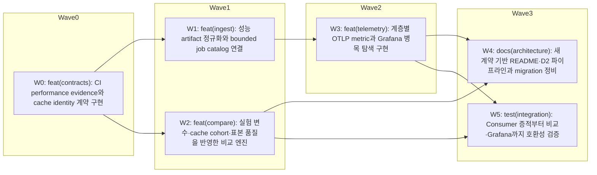
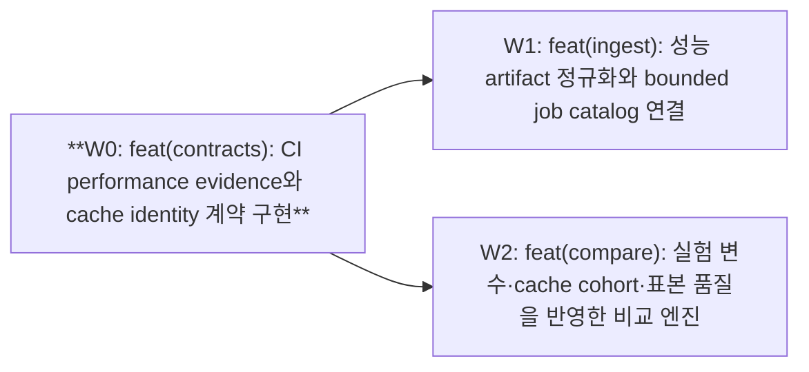
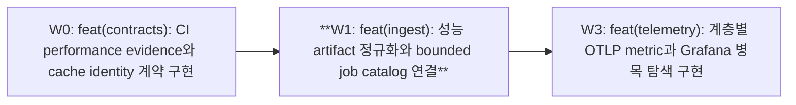
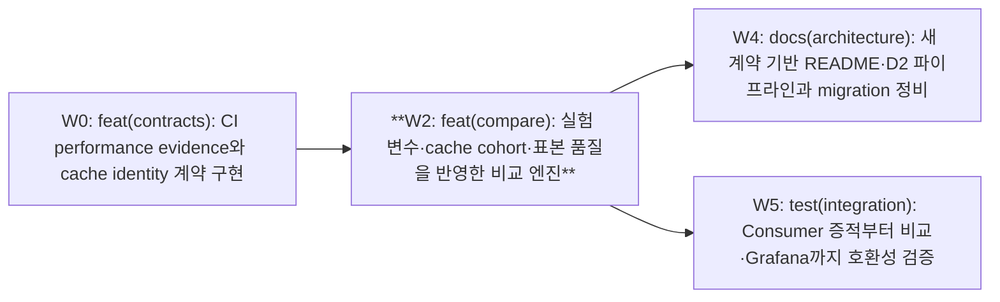
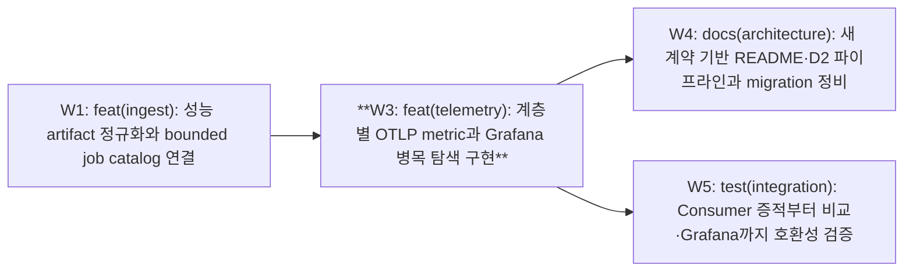
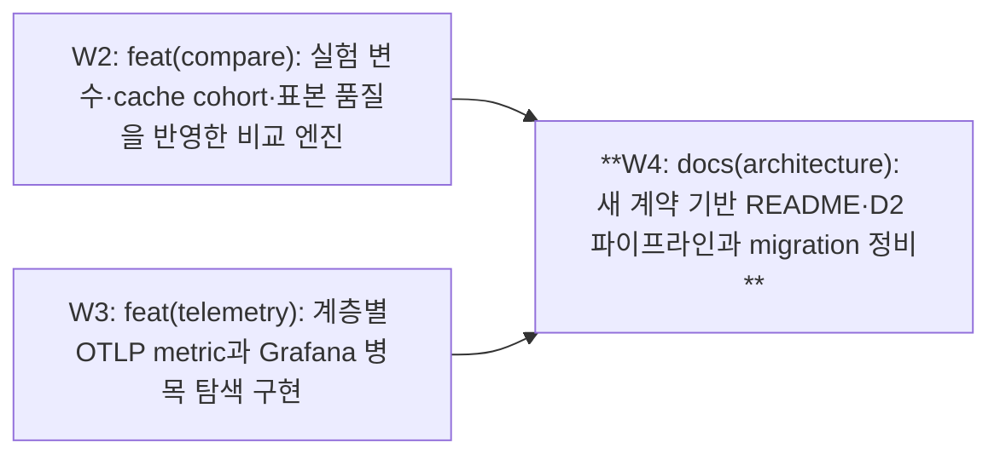
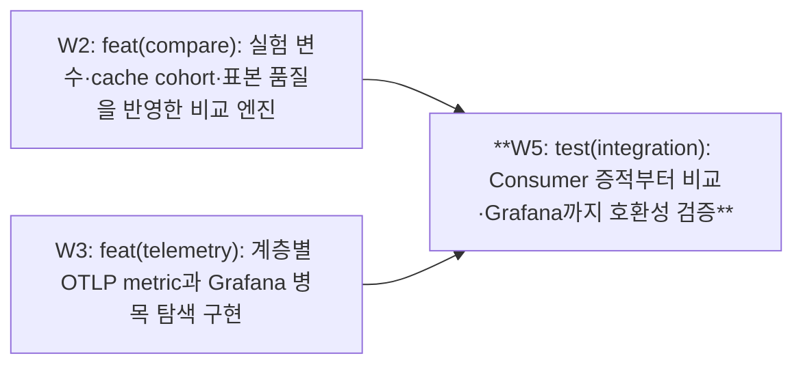

# Toolkit Issue 분해 제안과 본문 초안

> 승인 전 초안. 새 Issue는 아직 생성하지 않았다. #139 Root와 #140 문서 child를 재사용하고 신규 child 5개를 생성하는 안이다.

## Root #139 재구성 초안

### 목표

CI 병목을 source evidence로 설명하고 동일 조건의 성능 비교를 재현한다.

### 배경

현재 job timeline만으로 Gradle/Context/container 내부 비용을 구분하기 어렵고 댓글별 계약이 누적되어 충돌한다.

### 범위

schema, ingest, comparator, OTLP/Grafana, architecture docs, consumer validation

### 비범위

Backend collector 구현, Marketplace/PyPI, deployment authority, 기존 release threshold 변경

### 접근 방식

Consumer artifact → bounded validation → normalized model → offline comparison 또는 OTLP/Mimir/Tempo/Grafana

### 성공 기준

- 누락/중첩/조건 차이에서 false success가 없다
- source artifact에서 보고서와 Grafana까지 identity가 보존된다

### Child 목록

- [ ] W0: feat(contracts): CI performance evidence와 cache identity 계약 구현 (승인 후 신규 생성)
- [ ] W1: feat(ingest): 성능 artifact 정규화와 bounded job catalog 연결 (승인 후 신규 생성)
- [ ] W2: feat(compare): 실험 변수·cache cohort·표본 품질을 반영한 비교 엔진 (승인 후 신규 생성)
- [ ] W3: feat(telemetry): 계층별 OTLP metric과 Grafana 병목 탐색 구현 (승인 후 신규 생성)
- [ ] W4: docs(architecture): 새 계약 기반 README·D2 파이프라인과 migration 정비 (#140 재사용)
- [ ] W5: test(integration): Consumer 증적부터 비교·Grafana까지 호환성 검증 (승인 후 신규 생성)

### 의존 관계

W0 → W1/W2; W1 → W3; W2/W3 → W4/W5. Root 자체는 구현 dependency가 아니다.

### Execution Waves와 통합 Gate

- Wave 0: W0. JSON Schema와 legacy/new fixture 통합 통과 후 W1/W2 착수.
- Wave 1: W1/W2 병렬. W1 normalized identity/quality gate 통과 후 W3 착수. W2 비교 계약은 별도 검증.
- Wave 2: W3. W2·W3가 연결된 normalized→comparison/OTLP→local Grafana 왕복 gate 통과 후 W4/W5 착수.
- Wave 3: W4/W5 병렬. diagram/query/source와 consumer fixture identity를 합쳐 최종 검증.

### 위험과 완료 기준

- legacy cache identity 추론 오류
- collector 미완료 상태의 live 검증 과장
- overlap duration 이중 합산
- 모든 child 검증과 wave integration gate 통과
- Backend #867의 live consumer evidence 확인
- README/diagram/manifest가 같은 계약을 설명

## W0 — feat(contracts): CI performance evidence와 cache identity 계약 구현

### 목표

Consumer가 구현할 versioned envelope와 legacy adapter를 schema/fixture로 확정한다.

### 배경과 선행 계약

#139 Root. 신규 ci-performance-evidence/1.0은 기존 module schema와 별도 namespace다. W1과 W2의 공통 입력 계약을 제공한다.

### 범위

source/run/attempt/producer/toolchain identity, clock/quality, optional layer timing, cache policy/outcome/seed, test universe와 selected digest, selected/executed_now/verified_from_cache 계약

### 비범위

raw 수집 코드와 metric exporter, 실제 Backend collector

### 구현 지침

Legacy cache_state는 legacy-limited로 보존한다. 필드명·타입·enum은 JSON Schema와 fixture에서 확정한다. missing을 zero로 변환하지 않고 비유한/음수·중복 key·크기 초과를 거부한다. 기존 승인 정책을 변경하지 않는다.

### 관련 코드

schemas/, src/pipeline_toolkit/contracts/, tests/fixtures/

### Dependencies와 Blocks

- 선행: 없음 (Wave 0)
- 후행: W1, W2

### 그래프 위치

### 예상 수정 경로

- `schemas/ci-performance-evidence-1.0.json`
- `src/pipeline_toolkit/contracts/performance_evidence.py`
- `src/pipeline_toolkit/contracts/module_evidence.py`
- `tests/test_performance_evidence.py`
- `tests/fixtures/performance-evidence/`

### 병렬 작업 안전성

Wave 0 단독. 이후 schema 변경은 계약 PR로 먼저 반영한다.

### Acceptance Criteria

- [ ] valid/partial/unavailable/legacy fixture를 결정론적으로 읽는다
- [ ] dependency warm/Build cold/Configuration disabled mixed cache를 보존한다
- [ ] NaN/음수/duplicate/oversize와 invalid identity fixture를 거부한다
- [ ] legacy cache 문자열에서 layer별 상태를 추론하지 않는다
- [ ] 신규 writer와 legacy reader round-trip fixture가 있다

### 검증 방법

pytest tests/test_performance_evidence.py 및 기존 module/schema regression suite

## W1 — feat(ingest): 성능 artifact 정규화와 bounded job catalog 연결

### 목표

Actions와 layer evidence를 안전하게 하나의 normalized execution으로 병합한다.

### 배경과 선행 계약

W0의 versioned envelope와 legacy-limited quality를 입력으로 사용한다. 논리 job ID는 spring-full/spring-affected이며 표시명과 독립이다.

### 범위

artifact bounds/identity 검증, normalized timing, clock anchor와 overlap quality, duplicate run/attempt 처리, catalog mapping과 unmapped other

### 비범위

OTLP serialize와 benchmark 판정, consumer 내부 instrumentation

### 구현 지침

artifact command를 실행하지 않는다. task completion으로 configuration/bytes를 추정하지 않는다. graph가 없으면 critical_path_quality=unavailable. source conclusion과 export 상태를 분리한다.

### 관련 코드

src/pipeline_toolkit/telemetry/timeline.py, src/pipeline_toolkit/github/artifacts.py, 신규 normalize adapter

### Dependencies와 Blocks

- 선행: W0
- 후행: W3

### 그래프 위치

### 예상 수정 경로

- `src/pipeline_toolkit/telemetry/timeline.py`
- `src/pipeline_toolkit/normalize/performance.py`
- `src/pipeline_toolkit/github/artifacts.py`
- `tests/test_performance_ingest.py`

### 병렬 작업 안전성

W2는 compare/experiments 전용 파일을 수정한다. W0 schema는 읽기 전용이며 변경 필요 시 공동 계약부터 갱신한다.

### Acceptance Criteria

- [ ] same-run Actions+performance fixture identity가 normalized manifest에서 유지된다
- [ ] foreign SHA/attempt, oversized archive, 중복 fixture를 거부하거나 명시적 quality로 처리한다
- [ ] 한국어 표시명을 바꿔도 같은 logical ID이고 unmapped는 other다
- [ ] 중첩 span과 process별 clock이 잘못된 합계/critical path를 만들지 않는다
- [ ] source failure/cancel/partial이 false success로 바뀌지 않는다

### 검증 방법

pytest tests/test_performance_ingest.py와 기존 timeline/artifact/security tests

## W2 — feat(compare): 실험 변수·cache cohort·표본 품질을 반영한 비교 엔진

### 목표

비교할 수 있는 실험과 근거가 부족한 결과를 구분하는 deterministic report를 제공한다.

### 배경과 선행 계약

W0 envelope fixture를 사용하므로 W1 production ingest가 없어도 구현 가능하다. Cache 도입과 affected selection은 사전 선언한 차이를 허용한다.

### 범위

experiment allowed variables, universe/selected digest 구분, cold/warm/realistic profile, AB/BA 계획, 개별값/중앙값/범위/실패·취소/비용/overhead와 sample sufficiency

### 비범위

live workflow dispatch, release threshold 변경, remote cache 구축

### 구현 지침

초기 3~5회에 p95를 확정하지 않는다. rolling 동일 cohort 14일 100건은 초기 정책으로 version한다. 원시 분위수와 histogram 추정 분리. CLI가 지원하지 않는 인자는 가이드에 넣지 않는다.

### 관련 코드

src/pipeline_toolkit/compare/, experiments/compare.py, reports/

### Dependencies와 Blocks

- 선행: W0
- 후행: W4, W5

### 그래프 위치

### 예상 수정 경로

- `src/pipeline_toolkit/compare/performance.py`
- `src/pipeline_toolkit/experiments/compare.py`
- `src/pipeline_toolkit/reports/performance.py`
- `tests/test_performance_comparison.py`

### 병렬 작업 안전성

W1 normalized fixture는 W0 계약으로 대체한다. W1/W3의 timeline/telemetry 파일은 수정하지 않는다.

### Acceptance Criteria

- [ ] 같은 입력 offline replay 결과가 동일하다
- [ ] affected selected digest 차이와 cache enablement의 선언된 차이는 허용한다
- [ ] 선언되지 않은 runner/toolchain/schema/profile 차이는 설명 가능한 incomparable다
- [ ] seed는 warm 표본에서 제외하고 failure/cancel/exclusion 분모를 보존한다
- [ ] 소표본 p95는 insufficient-samples이고 100건 경계·window fixture가 있다
- [ ] 기존 release approval threshold 결과가 회귀하지 않는다

### 검증 방법

pytest tests/test_performance_comparison.py 및 기존 experiment/module comparator regression

## W3 — feat(telemetry): 계층별 OTLP metric과 Grafana 병목 탐색 구현

### 목표

정규화된 layer evidence를 bounded metric/trace와 검증된 dashboard로 제공한다.

### 배경과 선행 계약

W1 normalized evidence와 stable job catalog를 사용한다. 보고서와 exporter는 같은 source identity를 유지하며 원본 verdict를 바꾸지 않는다.

### 범위

histogram buckets/temporality, layer metric/trace, replay, dashboard cohort·waterfall·quality·비용, local receiver/Mimir-compatible Prometheus/Tempo/Grafana smoke

### 비범위

비교 알고리즘 변경, Cloud credential 발급, runtime source 수집

### 구현 지침

metric label은 finite category만 허용. run/SHA/test name은 trace/manifest. 중첩 구간은 test 시간에 다시 더하지 않으며 snapshot gauge에 rate를 적용하지 않는다. generated dashboard는 canonical generator로 갱신한다.

### 관련 코드

src/pipeline_toolkit/telemetry/model.py, transform.py, export.py, scripts/build_ci_dashboard.py, observability/

### Dependencies와 Blocks

- 선행: W1
- 후행: W4, W5

### 그래프 위치

### 예상 수정 경로

- `src/pipeline_toolkit/telemetry/model.py`
- `src/pipeline_toolkit/telemetry/transform.py`
- `src/pipeline_toolkit/telemetry/export.py`
- `scripts/build_ci_dashboard.py`
- `observability/`
- `tests/test_performance_telemetry.py`
- `scripts/ci_dashboard_smoke.py`

### 병렬 작업 안전성

W2はreport/comparator専用。共通既存 test fixtureの変更が必要なら先にW0/W1へ契約反映する。

### Acceptance Criteria

- [ ] bucket/count/sumとtemporalityをreceiver fixtureで照合する
- [ ] replay/restart/retryで二重計数せずsource conclusionを保持する
- [ ] label/span budget超過を拒否しraw identityをlabelに出さない
- [ ] durationの中にContext/container/Flywayをwaterfallで表示する
- [ ] Grafana→Tempo→Actions/manifestリンクが同一runを指す
- [ ] local success/failure/outage/replay smokeが通る

### 검증 방법

pytest tests/test_performance_telemetry.py; build_ci_dashboard.py --check; disposable local dashboard/outage smoke

## W4 — docs(architecture): 새 계약 기반 README·D2 파이프라인과 migration 정비

### 목표

初見の開発者がsourceからGrafanaまでと現在/計画の差を理解できる文書を提供する。

### 배경과 선행 계약

既存#140を再利用。W2の比較結果とW3の実装済みmetric/queryを正確に説明する最終文書タスクであり、現時点の草案は先行して作成できる。

### 범위

README overview、context/sequence/lineage/replay、D2 source/SVG、選択的Archify、old/new用語・schema migration、生成物CI検査

### 비범위

schema/collector/exporterの実装とMarketplace化

### 구현 지침

live guideを更新しhistorical数値/identityは保持。CI/Module Benchmark/CI Observability identityは維持。Archify未採用でもD2/SVG/Mermaidとsource evidenceは必須。

### 관련 코드

README.md, docs/architecture/, docs/telemetry/, 新規diagram generator check

### Dependencies와 Blocks

- 선행: W2, W3
- 후행: 없음

### 그래프 위치

### 예상 수정 경로

- `README.md`
- `docs/architecture/`
- `docs/telemetry/`
- `docs/diagrams/`
- `scripts/check_pipeline_docs.py`
- `tests/test_pipeline_docs.py`

### 병렬 작업 안전성

W5はconsumer fixtureとworkflow gate専用。共通README編集はW4のみ、W5は検証結果をartifactで渡す。

### Acceptance Criteria

- [ ] ownership/consume方式、一般CI/module/releaseの差を説明する
- [ ] current/planned legendとsource SHA/linkを図に付ける
- [ ] D2→SVG driftと内部リンク/alt textをCIで検査する
- [ ] cold/warm/p95/quality/queryがW2/W3の契約と一致する
- [ ] historical reportを改変せずmigration noteで接続する
- [ ] 図のclipping/contrastをrenderして確認する

### 검증 방법

docs/link/drift tests; pinned D2 render; Mermaid parse; SVG preview; Archify採用時finalize/browser check

## W5 — test(integration): Consumer 증적부터 비교·Grafana까지 호환성 검증

### 목표

契約単体だけでなくconsumerが生成する形のartifactを端から端まで検証する。

### 배경과 선행 계약

W2 comparatorとW3 OTLP/Grafanaを統合する。Backend #867 collectorは外部依存。未完成ならsynthetic fixture検証のみ完了しlive rolloutはpendingとしてRootに残す。

### 범위

representative consumer artifact, pinned-SHA invoke、旧新reader、manifest/report/trace identity、CI verification wiring、upgrade evidence handoff

### 비범위

Backend production code変更、live benchmark自動dispatch、release自動merge・公開

### 구현 지침

Toolkit refをimmutable SHA固定。Backend ownerがcollectorを実装後同一refでbaseline/candidateを採る。release実行は既存Git Flowで行い、このIssueのテスト成功だけで自動公開しない。

### 관련 코드

tests/fixtures/consumer-performance/, tests/test_consumer_performance_integration.py, scripts/verify_toolkit.sh, .github/workflows/ci.yml

### Dependencies와 Blocks

- 선행: W2, W3
- 후행: 없음

### 그래프 위치

### 예상 수정 경로

- `tests/fixtures/consumer-performance/`
- `tests/test_consumer_performance_integration.py`
- `scripts/verify_toolkit.sh`
- `.github/workflows/ci.yml`

### 병렬 작업 안전성

W4がREADME/docsとdiagram検証を担当する。W4はCI yamlを触らずcheck scriptを提供し、ここで統合する。

### Acceptance Criteria

- [ ] success/failure/cancel/partial/mixed-cache consumer fixtureがend-to-endで整合する
- [ ] foreign ref/SHA/attemptと実行可能artifactをfail-closed処理する
- [ ] legacy-limitedとnew envelopeの互換/非互換を検査する
- [ ] source CI verdictがexport outageで変わらない
- [ ] consumer upgrade用SHA・schema・変更一覧・未検証live項目をartifactに残す
- [ ] Toolkit全verificationで新suiteが実行される

### 검증 방법

pytest tests/test_consumer_performance_integration.py; bash scripts/verify_toolkit.sh; local round-trip evidence

## GitHub 적용 계획

승인 후 #139 본문을 Root로 갱신하고 W0/W1/W2/W3/W5를 새 Issue로 생성한다. #140을 W4로 재사용한다. 실제 번호로 각 본문의 DAG와 선행/후행을 갱신하고 GitHub native Sub-Issue·blocked-by 관계를 생성 후 조회해 검증한다. 지원되지 않는 gh 옵션은 가정하지 않고 API 지원을 확인한다. Backend #867은 별도 저장소의 collector/live rollout 작업으로 연결하고 Root를 막는 외부 완료 조건으로 추적한다. 기존 Issue는 삭제하거나 닫지 않는다.
