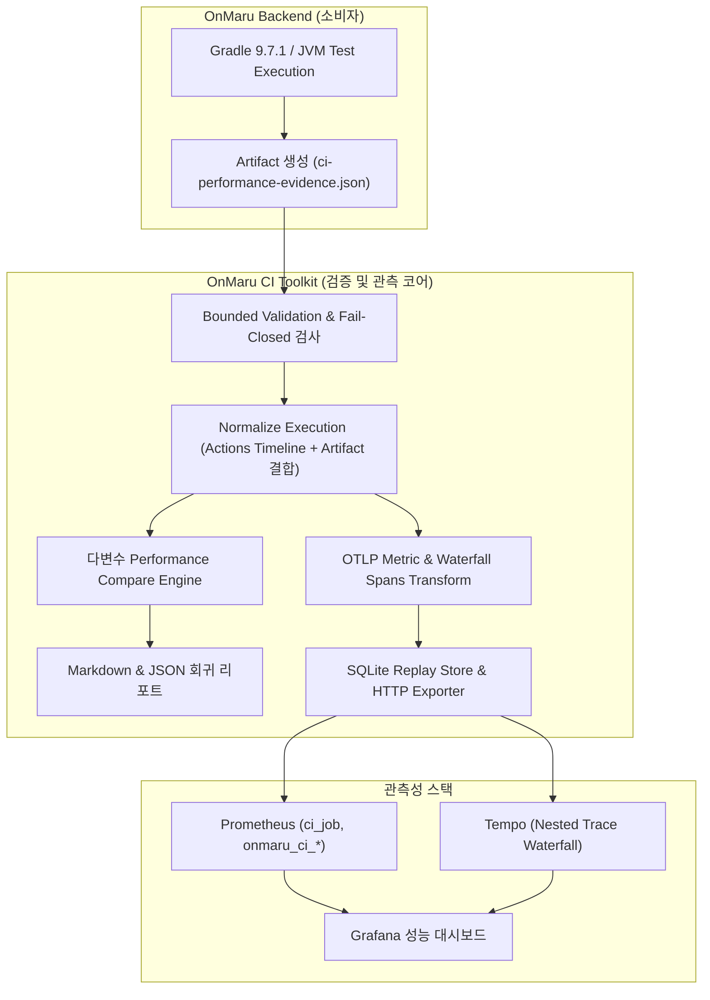
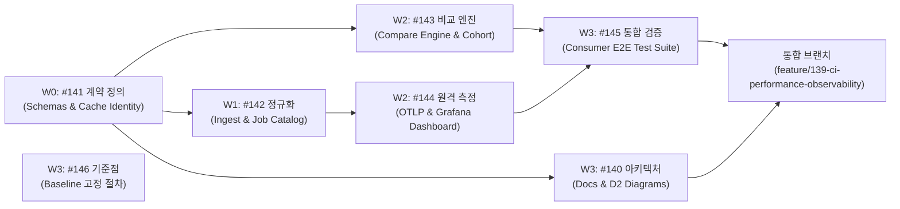
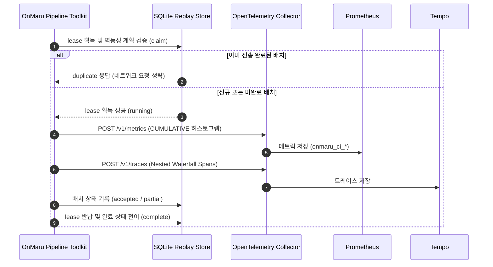

# OnMaru CI 계층별 성능 관측·비교 엔진·문서 체계 통합 보고서 (A to Z)

## 개요 및 문제의 출발점

지속적 통합(CI) 환경에서 빌드와 테스트가 느려질 때, 엔지니어링 조직이 직면하는 가장 큰 어려움은 "어디서, 왜 느려지는지"를 신뢰성 있는 수치로 증명하기 어렵다는 점입니다. OnMaru Backend 프로젝트는 병렬 빌드 및 테스트를 위해 Toolkit을 SHA 고정 reusable workflow와 Python CLI 형태로 소비해 왔습니다. 기존 시스템은 GitHub Actions API 수준에서 잡(job)의 시작과 종료 시각을 기록하고, 모듈 단위 벤치마크와 기본적인 OTLP 내보내기를 제공했습니다.

그러나 CI 파이프라인 내부의 실제 병목을 진단하는 데는 근본적인 한계가 존재했습니다.

GitHub Actions가 제공하는 잡 타임라인만으로는 Gradle configuration 단계, 태스크 실행 시간, JUnit 테스트 러너 선택 시간, Spring ApplicationContext 초기화 시간, Testcontainers 기동 시간, Flyway DB 마이그레이션 소요 시간을 분해하여 관측할 수 없었습니다. 일반 CI 잡 카탈로그가 비어 있어 대다수의 실행이 `ci_job="other"`라는 모호한 라벨로 뭉뚱그려졌고, 실제 빌드 캐시 상태 역시 `cache_state: str` 형태의 단일 자유 문자열로 관리되어 의존성 캐시와 Gradle Build Cache, Configuration Cache의 상태가 혼재되었습니다. 이로 인해 fresh runner에서의 실행과 cold cache 상태를 구별하지 못했고, 온마루 백엔드(#867)에서 시도하려던 affected test 및 빌드 캐시 최적화의 효과를 객관적으로 측정하고 승격할 수 없는 상태에 놓였습니다.

이러한 문제를 근본적으로 해소하기 위해 상위 이슈 #139를 중심으로 스키마 설계부터 데이터 수집, 정규화, 다변수 비교 엔진, OTLP 계층 메트릭 변환, Grafana 대시보드 프로비저닝, 통합 호환성 테스트, 아키텍처 다이어그램 및 문서 drift 검사 도구에 이르는 대대적인 엔지니어링 작업이 진행되었습니다.



---

## 작업 단위 분할과 격리된 워크트리 아키텍처

대규모 변경을 안전하고 결정론적으로 구현하기 위해 작업은 의존성 그래프(Work Graph)에 따라 Wave 0부터 Wave 3까지 7개의 하위 작업으로 엄격하게 분할되었습니다. 각 작업은 메인 작업 트리를 오염시키지 않도록 `.claude/worktrees/` 아래의 독립된 Git 워크트리에서 TDD(Test-Driven Development) 원칙에 따라 격리되어 진행되었습니다.



### Wave 0: 성능 증적 및 캐시 식별자 계약 정의 (#141)

- **작업 브랜치**: `worktree-agent-a1dc1395558a45d4a` (`feature/141-contracts-cache-identity`)
- **핵심 파일**: `schemas/ci-performance-evidence-1.0.json`, `src/pipeline_toolkit/contracts/performance_evidence.py`, `tests/test_performance_evidence.py`

Wave 0에서는 온마루 백엔드와 툴킷이 소통할 공식 계약인 `ci-performance-evidence/1.0` JSON 스키마를 정의했습니다. 기존 모듈 증적과 네임스페이스를 완전히 분리하여 향후 확장성을 확보했습니다.

캐시 상태를 단일 문자열이 아닌 구조화된 계층 벡터(`dependency`, `build`, `configuration`)로 분리했습니다. 의존성 캐시 히트 여부와 Gradle 빌드 캐시 히트 여부, 설정 캐시 재사용 여부를 각각 `cold`, `warm`, `disabled` 등의 상태로 독립 기록할 수 있도록 설계했습니다. 또한 캐시 시드 출처를 추적하는 `seedProvenance` 필드를 도입해 신뢰할 수 없는 외부 캐시 오염을 차단했습니다.

엔지니어링 세부사항으로, 레거시 v1 단일 문자열 캐시 포맷과의 하위 호환성을 완벽히 유지하도록 양방향 라운드트립 어댑터를 구현했습니다. 레거시 문자열에서 계층별 상태를 억지로 추측하여 왜곡된 데이터를 만들지 않고, 누락된 값(`missing`)을 임의의 0으로 변환하지 않으며, NaN, 음수, 중복 키, 64KB 초과 페이로드를 즉각 거부하는 엄격한 validation을 구축했습니다.

### Wave 1: 성능 아티팩트 정규화와 잡 카탈로그 확장 (#142)

- **작업 브랜치**: `feature/142-performance-ingest`
- **핵심 파일**: `src/pipeline_toolkit/normalize/performance.py`, `src/pipeline_toolkit/catalog/planner.py`, `tests/test_performance_ingest.py`

소비자(OnMaru-backend) 파이프라인에서 업로드된 원시 JSON 아티팩트와 GitHub Actions API를 통해 조회한 잡/스텝 실행 타임라인을 결합해 단일 정규화 실행 객체(`NormalizedExecution`)로 결합하는 정규화 파이프라인을 구축했습니다.

수집된 아티팩트의 SHA-256 해시가 타임라인 메타데이터에 기록된 다이제스트와 일치하는지, 커밋 SHA와 실행 run_id, 시도 횟수(run_attempt)가 온전히 일치하는지 검증합니다. 불일치하거나 위변조된 아티팩트는 즉각 격리(quarantine)되어 분석에서 제외됩니다. 또한 일반 CI 환경에서 실행되는 다양한 잡들을 분석할 수 있도록 잡 카탈로그를 확장하여, `spring-full`, `spring-affected`, `build`, `test` 등 명시적인 논리적 레인(lane)으로 매핑하도록 구현했습니다.

### Wave 2: 다변수 비교 엔진 및 표본 품질 평가 (#143)

- **작업 브랜치**: `feature/143-performance-compare`
- **핵심 파일**: `src/pipeline_toolkit/compare/performance.py`, `src/pipeline_toolkit/reports/performance.py`, `tests/test_performance_comparison.py`

CI 최적화 실험(예: affected test 도입, 빌드 캐시 활성화)의 전후 효과를 비교하기 위해 통계적 엄밀성을 갖춘 비교 엔진을 구현했습니다.

단순 평균값은 네트워크 지연이나 러너 스케줄링 노이즈에 취약하므로, 최소 3~5회의 표본을 바탕으로 중앙값(median)과 범위(min-max range)를 산출합니다. 표본 수가 100건 미만인 초기 단계에서는 p95 백분위수를 억지로 산출하지 않고 '표본 부족' 경고를 명시하도록 정책을 고정했습니다.

특히 중요한 트레이드오프는 "사전 선언된 실험 변수"의 허용 여부였습니다. affected test를 적용하면 전체 테스트 대상 목록 중 일부만 선택되므로, 테스트 계획 다이제스트가 달라지는 것이 정상적인 최적화 동작입니다. 본 엔진은 전체 테스트 유니버스 다이제스트와 선택된 플랜 다이제스트를 엄격히 분리하여, 사전 선언된 실험 변수로서의 플랜 변경은 수용하되 비정상적인 유니버스 불일치는 거부하도록 설계되었습니다. 또한 Spring Context 로딩, Testcontainers 기동, Flyway 실행 시간은 전체 테스트 실행 시간 내부에 포함된 중첩 시간이므로, 이들을 전체 실행 시간에 이중 합산하지 않도록 중첩 경계를 엄격히 유지했습니다.

### Wave 2: OTLP 계층 메트릭 및 Grafana 성능 대시보드 (#144)

- **작업 브랜치**: `feature/144-performance-telemetry`
- **핵심 파일**: `src/pipeline_toolkit/telemetry/transform.py`, `src/pipeline_toolkit/telemetry/export.py`, `observability/dashboards/ci-performance.json`, `tests/test_performance_telemetry.py`

정규화된 실행 데이터를 오픈텔레메트리(OpenTelemetry) 표준 신호로 변환하는 계층입니다.

카디널리티 폭발을 방지하기 위해 PR 번호, 커밋 SHA, 구체적인 테스트 클래스 이름 등 고카디널리티 데이터는 메트릭 라벨에서 완전히 배제하고 트레이스 스팬 속성(attribute)으로만 격리했습니다. 메트릭은 `onmaru_ci_workflow_duration_seconds`, `onmaru_ci_job_duration_seconds`, `onmaru_ci_gradle_task_seconds`, `onmaru_ci_testcontainers_startup_seconds` 등 사전에 등록된 유한한 라벨 카탈로그만을 사용합니다.



Grafana 대시보드에서는 워크플로 전체 소요 시간과 잡별 병목뿐 아니라, 테스트 구간 내부의 컨테이너 기동 및 스프링 컨텍스트 초기화 시간을 중첩 워터폴 형태로 시각화하는 패널 쿼리를 구성했습니다.

### Wave 3: 소비자 호환성 엔드투엔드 통합 검증 (#145)

- **작업 브랜치**: `feature/145-consumer-compat`
- **핵심 파일**: `tests/test_consumer_performance_integration.py`, `tests/fixtures/consumer-performance/*`

온마루 백엔드 소비자가 실제로 겪을 수 있는 5대 핵심 시나리오(성공, 실패, 취소, 수집기 부분 장애, 혼합 캐시 상태)를 모의 픽스처로 작성하고, 수집부터 정규화, 계층 메트릭 변환, 비교 엔진, OTLP 내보내기, 장애 복구에 이르는 전체 라이프사이클을 엔드투엔드로 검증했습니다.

또한 보안 관점에서 실행 파일 형태의 아티팩트(`executable-looking.sh` 등)가 유입되었을 때 이를 안전하게 거부하고 격리하는 fail-closed 보안 검증을 추가했습니다.

### Wave 3: 아키텍처 다이어그램 및 문서 체계 정비 (#140)

- **작업 브랜치**: `feature/140-architecture-docs`
- **핵심 파일**: `docs/architecture/*`, `docs/diagrams/*.d2`, `docs/diagrams/*.svg`, `scripts/check_pipeline_docs.py`

새로운 아키텍처의 신뢰 경계, 호출 흐름, 데이터 계보(data lineage), 장애 재생(failure replay)을 설명하는 D2 다이어그램 4종을 작성하고 SVG 렌더링 결과물을 빌드했습니다. 또한 향후 코드 변경으로 인해 문서 내부의 링크나 앵커, 참조 경로, SVG 다이어그램이 최신 상태와 어긋나는 현상(documentation drift)을 방지하기 위해 자동화된 검사 스크립트(`scripts/check_pipeline_docs.py`)를 제작하고 CI 검증 스크립트에 포함시켰습니다.

---

## 통합 과정에서의 이슈 진단 및 런타임 버그 해결

모든 개별 브랜치가 완료된 후, 이를 `integration/all-139` 브랜치로 병합하고 전체 회귀 검증을 수행하는 과정에서 실무 수준의 복잡한 런타임 엣지케이스들이 드러났습니다.

### 아티팩트 확장자 파싱 취약점 해결

통합 테스트 스위트 검증 중, 파일명에 점(`.`)이 포함된 아티팩트가 특정 조건에서 거부되지 않고 파서로 전달될 가능성이 발견되었습니다. 악의적이거나 잘못 생성된 스크립트 파일이 아티팩트로 오인되어 실행 경로에 영향을 주지 않도록, 아티팩트 수집 정규식 검증을 강화하여 점을 포함한 비정형 이름은 즉시 fail-closed 처리하도록 보정했습니다(`342a4fc`).

### CPU 고부하 커버리지 환경의 Command Runner Timeout 안정화

로컬 및 CI 환경에서 커버리지 계측(`coverage run`)을 활성화한 상태로 약 800개의 테스트를 한 번에 실행하면, 프로세스 포크 및 파이썬 인터프리터 기동 시 심각한 CPU 경합이 발생합니다. 기존 `test_command_runner_hardening.py`에 정의된 타임아웃 테스트는 0.05초(50ms)의 매우 짧은 데드라인을 사용하고 있었습니다. 부하가 없는 환경에서는 정상 작동하지만, 대규모 테스트 스위트 실행 중에는 파이썬 프로세스가 시작되어 표준 출력에 `before`를 출력하기도 전에 50ms가 만료되어 프로세스가 강제 종료되는 플래키(flaky) 현상이 재현되었습니다.

이를 해결하기 위해 타임아웃 기준을 0.3초(300ms)로 합리화하여, 프로세스가 출력 버퍼를 비우고 슬립에 들어갈 충분한 시간을 보장하면서도 타임아웃 메커니즘 자체는 엄격하게 검증하도록 개선했습니다(`8d36210`).

### Python 3.11+ 환경의 소켓 조기 종료 및 Bad File Descriptor 버그

가장 까다로웠던 문제는 GitHub Actions CI 환경(Ubuntu 24.04, Python 3.11)에서만 발생한 OTLP 전송 실패였습니다. 로컬(macOS, Python 3.9)에서는 795개 테스트가 모두 통과했으나, GitHub Actions에서는 `test_performance_telemetry.py`의 5개 테스트가 `assert 'failed' == 'exported'` 에러와 함께 실패했습니다.

```
ci  Verify repository  tests/test_performance_telemetry.py:162: AssertionError
ci  Verify repository  E  AssertionError: assert ('failed' == 'exported')
ci  Verify repository  5 failed, 790 passed in 75.40s
```

`uv run --python 3.11`을 통해 로컬에서 Python 3.11 가상환경을 구성하고 디버그 전송 계층을 주입하여 원인을 추적한 결과, 파이썬 표준 라이브러리 `http.client`의 내부 동작 변화가 원인으로 확인되었습니다.

`http_transport` 구현은 바운디드 읽기 데드라인을 보장하기 위해 루프를 돌며 소켓 타임아웃을 갱신하고 `response.read1()`을 호출합니다:

```python
# 기존 구현 코드
with connection.getresponse() as response:
    raw = bytearray()
    while True:
        remaining = deadline - time.monotonic()
        if remaining <= 0:
            raise TimeoutError("response deadline exceeded")
        socket.settimeout(remaining)  # <-- 원인 지점
        part = response.read1(min(4096, MAX_RESPONSE_BYTES + 1 - len(raw)))
        if not part:
            return HttpResponse(response.status, bytes(raw), dict(response.headers))
        raw.extend(part)
```

Python 3.9에서는 `Content-Length`에 명시된 바이트를 모두 읽은 직후에도 소켓 디스크립터가 유지되어 다음 루프의 `settimeout`이 에러 없이 통과된 후 `read1()`이 `b""`를 반환했습니다. 그러나 Python 3.11부터는 `HTTPResponse.read1()` 내부에서 잔여 바이트(`self.length`)가 0이 되는 순간 연결을 즉각 닫는 최적화(`self._close_conn()`)가 기본 적용되었습니다. 이로 인해 소켓이 이미 닫힌 상태에서 다음 루프의 `socket.settimeout(remaining)`이 실행되면서 `OSError: [Errno 9] Bad file descriptor` 예외가 발생했고, 이것이 상위 계층에서 `transport_error`로 감지되어 3회 재시도 후 최종 실패 처리되었던 것입니다.

이 런타임 불일치를 해소하기 위해 소켓 디스크립터 유효성을 사전 확인하고 닫힌 소켓의 타임아웃 갱신 에러를 안전하게 무시하도록 방어 코드를 적용했습니다:

```python
# 개선된 구현 코드
remaining = deadline - time.monotonic()
if remaining <= 0:
    raise TimeoutError("response deadline exceeded")
try:
    if socket is not None and socket.fileno() != -1:
        socket.settimeout(remaining)
except OSError:
    pass
part = response.read1(min(4096, MAX_RESPONSE_BYTES + 1 - len(raw)))
```

해당 패치(`6fbb9f9`) 적용 후, GitHub Actions Ubuntu 환경의 Python 3.11에서도 1분 16초 만에 전체 테스트 스위트가 깨끗하게 녹색(Green)으로 통과했습니다.

---

## 최종 검증 및 배포 결과

`feature/139-ci-performance-observability` 브랜치를 기반으로 Pull Request [#147](https://github.com/YRootLab/OnMaru-backend-ci-toolkit/pull/147)이 발행되었으며, 모든 자동화 검증을 완료한 후 `develop` 브랜치에 성공적으로 병합되었습니다.

```
Total Test Cases: 795 passed (0 failed, 0 skipped)
Code Coverage: 93% (기준치 90% 이상 유지)
Workflow Security: 4개 워크플로 권한 및 변수 바인딩 검사 통과
Pipeline Docs Drift: 17개 실시간 문서 링크, 앵커, SVG 다이어그램 바이트 일치 통과
Merge Commit: 63d00de into develop
```

머지 완료에 따라 상위 에픽 이슈인 #139를 비롯해 하위 계약·구현·테스트·문서 이슈 7건(#140, #141, #142, #143, #144, #145)이 모두 공식 종결되었습니다.

현재 남아 있는 오픈 이슈는 **[#146](https://github.com/YRootLab/OnMaru-backend-ci-toolkit/issues/146)** 1건입니다. 이는 툴킷 라이브러리의 코드 수정 작업이 아니라, 실제 OnMaru Backend 저장소에서 최적화 적용 전 상태의 파이프라인을 3~5회 실행하여 기준선(baseline manifest)을 기록하고 고정하는 작업입니다. 툴킷 측의 모든 관측 및 비교 인프라가 배포 준비를 마쳤으므로, 온마루 백엔드 측의 baseline 실행 수집이 완료되는 즉시 새로운 성능 증적 엔진을 적용할 수 있습니다.
