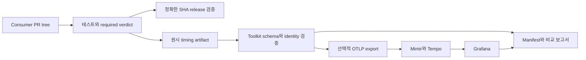

# CI 성능 비교는 측정 경계와 승격할 commit을 함께 보존한다

상태: 2026-11-20 설계 보강, 구현 전. 관련 작업은 #139와 #140이며 consumer는 OnMaru Backend #867이다. 현재 구현과 아래 목표를 혼동하지 않는다.

## 실행과 관측은 서로 다른 증거를 만든다

*테스트 판정은 consumer가 소유하며 Grafana는 manifest와 같은 원천을 시각화한다. 위 그림은 목표 구조이며 새 계층별 collector와 schema는 #139에서 구현한다.*

현재 Toolkit은 SHA-pinned reusable workflow와 source checkout Python CLI/module로 소비된다. Marketplace 배포나 PyPI 설치를 전제로 하지 않는다. 새 contract는 consumer가 만든 artifact를 읽고 검증하며 artifact의 command나 script를 실행하지 않는다.

## 기존 제안의 비교 조건을 수정한다

| 기존 제안의 한계 | 보정 계약 |
|---|---|
| 3~5회로 p95 성과 확정 | 초기 중앙값·범위만 판정, rolling 동일 cohort 100건/14일 이후 p95와 표본 수 표시 |
| 모든 test plan digest 동일 요구 | 전체 universe와 selected plan 분리, affected 실험은 selected digest 차이 허용 |
| cache policy 차이를 모두 비교 불가 처리 | cache 도입 실험의 disabled/enabled 차이는 사전 선언된 실험 변수로 허용 |
| warm이라는 문자열로 cache 결과 요약 | layer별 정책·seed identity와 실제 hit/miss outcome 분리 |
| task 시간으로 정확한 critical path 추정 | graph 없으면 unavailable, 중첩 구간과 causal path 구분 |
| 병합 후 녹색이면 release 허용 | 승격할 정확한 SHA·workflow·attempt의 full regression 성공 필요 |

100건/14일은 OnMaru 초기 정책이며 통계적 보장이나 공식 표준이 아니다. 초기 표본은 AB/BA 순서로 교차 실행하고 표본 수를 사전 등록한다. 실패·취소·eviction도 안정성 분모와 제외 기록에 보존한다.

## Schema와 시각화는 같은 의미를 사용한다

새 evidence는 source universe digest, selected plan digest, collector version, schema version, runner/toolchain identity, cache layer policy, seed provenance와 실제 outcome을 구분한다. Cache에서 복원한 test 결과는 `verified_from_cache`로 기록하고 `executed_now`와 합쳐 이번 실행에서 테스트가 수행됐다고 표시하지 않는다.

Task completion event만으로 configuration, dependency resolution과 cache byte를 알 수 있다고 가정하지 않는다. 지원되는 공개 API가 없으면 unavailable로 둔다. 여러 process의 monotonic clock은 직접 비교하지 않고 UTC anchor와 uncertainty를 기록한다. Histogram은 explicit bucket과 temporality, restart와 duplicate replay 테스트를 제공하며 snapshot gauge에 rate를 적용하지 않는다.

Grafana의 시간 그래프는 task 안의 Spring Context/container/Flyway를 중첩 waterfall로 표현한다. Test duration에 초기화 시간을 다시 더하는 stacked chart는 금지한다. Cache 절약 시간은 검증된 대응 표본이 있을 때만 추정한다. cold/warm/realistic cohort와 source population을 dashboard 상단에 표시한다.

## 관측 계획을 재현 가능한 작업 순서로 바꾼다

collector off/on 비교와 Configuration Cache store/reuse 호환성을 먼저 검증한다. Consumer wrapper는 Gradle 9.7.1이므로 최신 문서 코드의 호환성을 해당 버전에서 테스트한다. BuildService 기반 completion listener를 사용하고 configuration callback이 cache hit에서 실행되지 않는 조건을 검사한다.

다음으로 문서·leaf·shared/domain·controller·persistence·Flyway·root build cohort를 측정한다. worker/cache/slice/affected를 한 번에 바꾸지 않고 각 실험의 허용 변수를 manifest에 기록한다. required feedback latency와 runner-minutes, concurrency, cache/artifact byte를 동시에 비교한다.

README의 Mermaid overview, D2 source/SVG, 선택적 Archify HTML은 같은 node/edge inventory에서 검토한다. 현재 구현은 실선, 계획은 점선과 legend로 구분하고 node evidence link와 source SHA를 남긴다. 그림을 생성했다고 runtime correctness가 검증됐다고 주장하지 않는다.

## 검증 기준과 근거를 연결한다

- schema test: identity 불일치, legacy-limited cache, selected plan의 허용 차이, 누락·NaN·음수·중복 거부
- timing test: 중첩 span, 다중 process clock, graph 부재, cache 복원과 실제 실행 구분
- metric test: histogram bucket/count/sum 일치, temporality, exporter retry와 duplicate replay
- report test: 표본 부족 p95 숨김, 실패·취소 분모, cold/warm/realistic cohort 분리
- visualization test: source/SVG drift, 링크, clipping, alt text, current/planned legend

근거는 [Gradle 성능 가이드](https://docs.gradle.org/current/userguide/performance.html), [Configuration Cache 요구사항](https://docs.gradle.org/current/userguide/configuration_cache_requirements.html), [GitHub merge queue](https://docs.github.com/en/repositories/configuring-branches-and-merges-in-your-repository/configuring-pull-request-merges/managing-a-merge-queue), [OTel metric model](https://opentelemetry.io/docs/specs/otel/metrics/data-model/)이다. 이 문서는 특정 기업 내부 사례를 검증했다고 주장하지 않는다.
